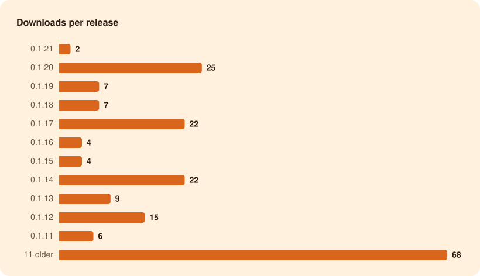

<h1 align="center">150 downloads</h1>

of Oyen Poni for Windows, from GitHub since 24 Oct 2026 Latest release, 0.1.20: <b>3</b> · Last 7 days: <b>150</b> · <b>11</b> stars on GitHub

## Per release

| Release | Published | Download button | Versioned installer | Portable zip | Other files | Total |
| --- | --- | --: | --: | --: | --: | --: |
| [0.1.20](https://github.com/lucacadalora/poni/releases/tag/v0.1.20) | 24 Oct 2026 | 2 | 1 | 0 | 0 | 3 |
| [0.1.19](https://github.com/lucacadalora/poni/releases/tag/v0.1.19) | 24 Oct 2026 | 4 | 1 | 0 | 2 | 7 |
| [0.1.18](https://github.com/lucacadalora/poni/releases/tag/v0.1.18) | 24 Oct 2026 | 4 | 2 | 1 | 0 | 7 |
| [0.1.17](https://github.com/lucacadalora/poni/releases/tag/v0.1.17) | 24 Oct 2026 | 6 | 5 | 1 | 3 | 15 |
| [0.1.16](https://github.com/lucacadalora/poni/releases/tag/v0.1.16) | 24 Oct 2026 | 1 | 2 | 0 | 1 | 4 |
| [0.1.15](https://github.com/lucacadalora/poni/releases/tag/v0.1.15) | 24 Oct 2026 | 2 | 1 | 0 | 1 | 4 |
| [0.1.14](https://github.com/lucacadalora/poni/releases/tag/v0.1.14) | 24 Oct 2026 | 14 | 4 | 4 | — | 22 |
| [0.1.13](https://github.com/lucacadalora/poni/releases/tag/v0.1.13) | 24 Oct 2026 | 7 | 1 | 1 | — | 9 |
| [0.1.12](https://github.com/lucacadalora/poni/releases/tag/v0.1.12) | 24 Oct 2026 | 10 | 2 | 2 | — | 14 |
| [0.1.11](https://github.com/lucacadalora/poni/releases/tag/v0.1.11) | 24 Oct 2026 | 2 | 1 | 3 | — | 6 |
| [0.1.10](https://github.com/lucacadalora/poni/releases/tag/v0.1.10) | 24 Oct 2026 | 1 | 1 | 0 | — | 2 |
| [0.1.9](https://github.com/lucacadalora/poni/releases/tag/v0.1.9) | 24 Oct 2026 | 4 | 5 | 3 | — | 12 |
| [0.1.8](https://github.com/lucacadalora/poni/releases/tag/v0.1.8) | 24 Oct 2026 | 3 | 0 | 3 | — | 6 |
| [0.1.7](https://github.com/lucacadalora/poni/releases/tag/v0.1.7) | 24 Oct 2026 | 2 | 1 | 0 | — | 3 |
| [0.1.6](https://github.com/lucacadalora/poni/releases/tag/v0.1.6) | 24 Oct 2026 | 5 | 1 | 2 | — | 8 |
| [0.1.5](https://github.com/lucacadalora/poni/releases/tag/v0.1.5) | 24 Oct 2026 | 6 | 3 | 1 | — | 10 |
| [0.1.4](https://github.com/lucacadalora/poni/releases/tag/v0.1.4) | 24 Oct 2026 | 1 | 2 | 0 | — | 3 |
| [0.1.3](https://github.com/lucacadalora/poni/releases/tag/v0.1.3) | 24 Oct 2026 | 2 | 1 | 0 | — | 3 |
| [0.1.2](https://github.com/lucacadalora/poni/releases/tag/v0.1.2) | 24 Oct 2026 | 1 | 3 | 0 | — | 4 |
| [0.1.1](https://github.com/lucacadalora/poni/releases/tag/v0.1.1) | 24 Oct 2026 | — | 6 | 0 | — | 6 |
| [0.1.0](https://github.com/lucacadalora/poni/releases/tag/v0.1.0) | 24 Oct 2026 | — | 1 | 1 | — | 2 |
| **All releases** | | **77** | **44** | **22** | **7** | **150** |

## Per day

| Day | Downloads |
| --- | --: |
| Today | 150 |

## On GitHub

11 stars · 2 forks · 0 watching

How we count

- GitHub counts every download of a release file. The Download button on the [website](https://lucacadalora.github.io/poni/) and in the README always fetches `Oyen-Poni-Setup.exe` from the newest release; the versioned installer and the portable zip are on each release's page.
- Our CI downloads Poni-Setup-0.1.1.exe (0.1.1) while it tests each push, and GitHub counts those too: 193 so far, left out of every number here ([ci-downloads.csv](data/ci-downloads.csv) lists each one). GitHub's own counters add up to 343.
- GitHub updates its counters every few minutes, so for a while a counter may not show a CI download that is already taken off. Each file's number keeps its highest reading, so numbers only go up.
- Still in the numbers: our own check of each new release (one download through the Download button) and any bots. GitHub can't tell those apart.
- Oyen Poni itself sends nothing: no accounts, no tracking. These are GitHub's download counters, read every hour.
- GitHub keeps no dates for downloads, so everything before the first reading counts on 24 Oct 2026.
- Page views and clones need a `METRICS_TOKEN` repository secret: a fine-grained token for this repository with Administration: Read-only. GitHub keeps them for 14 days only.

Updated 24 Oct 2026, 23:47 UTC by [Download stats](https://github.com/lucacadalora/poni/actions/workflows/metrics.yml), every hour · Data: [downloads](data/downloads.csv), [CI downloads](data/ci-downloads.csv), [stars](data/repo.csv), [summary.json](summary.json)
